<a href="https://durvesh-n-gangan.github.io/durvesh-n-gangan/">
<picture>
  <source media="(prefers-color-scheme: light)" srcset="./assets/gitworld/live/gitworld-light-db1c1f3e00.svg">
  
</picture>
</a>

Click the city to try other themes

### Hi, I'm Durvesh Niranjan Gangan

- Reach me: https://www.linkedin.com/in/durvesh-gangan-6796b731b

How this city works

- Every building is one of my repositories, so counting the buildings gives my repository count. Public repos have a name sign; private repos and this profile repo have none. Bigger and more-starred repos are taller.
- Each building is a timeline of its repo's past year. Its floors are months, from 12 months ago at the ground floor up to this month at the top, and the lit windows on a floor are my commits to that repo that month. A dark floor means no commits that month. If I pushed in the last day, the top floors flicker, like someone working late.
- An antenna with a blinking light on a tower means that repo has open issues. The more issues, the faster it blinks. No antenna means no open issues.
- The little creatures on the street are open issues as well.
- In some themes, a billboard stands on the repo I committed to most recently and scrolls its latest commit messages.
- The city is redrawn every hour from my GitHub activity.

