<a href="https://durvesh-n-gangan.github.io/durvesh-n-gangan/">
<picture>
  <source media="(prefers-color-scheme: light)" srcset="./assets/gitworld/live/gitworld-light-3cb8fb7375.svg">
  
</picture>
</a>

Click the city to try other themes

### Hi, I'm Durvesh Niranjan Gangan

- Reach me: https://www.linkedin.com/in/durvesh-gangan-6796b731b

How this city works

- Each tall tower with a name sign is one of my public repositories. Bigger and more-starred repos are taller.
- The more I've contributed in the last 7 days, the more windows are lit.
- The billboard stands on the repo I committed to most recently and scrolls its latest commit messages.
- A blinking red light with a red tag means that repo has open issues. The little creatures on the street are open issues too.
- The city is redrawn every hour from my GitHub activity.

Name signs, the billboard and issue tags appear in the themes that have signs, such as Classic blue, Neon rain and Cyberpunk.

