<picture>
  <source media="(prefers-color-scheme: light)" srcset="./assets/gitworld/gitworld-light.svg">
  
</picture>

<!-- gitworld:switcher (this block is redrawn automatically; edit outside it) -->

<b>Switch theme</b> · open, then click any theme to see my city in it

Winter night (showing now)


Classic blue

Synthwave


Neon rain

Diwali night


Pastel day


GitHub light

Sakura dusk


Golden hour

Game Boy 8-bit


Mars colony


Underwater city

Matrix terminal


Aurora night

Cyberpunk

Autumn evening


Halloween


New Year


Holi


Film noir


Desert oasis


Lunar base


<!-- /gitworld:switcher -->

### Hi, I'm Durvesh Niranjan Gangan

- Reach me: https://www.linkedin.com/in/durvesh-gangan-6796b731b

How this city works

The tallest towers are my top repositories (taller = more stars and code), more windows light up when I've been active that week, the billboard scrolls my latest commits, and the little monsters are open issues. A GitHub Action redraws it every hour from my real data, and the theme changes for festivals like Diwali, Holi and New Year.

