<a href="https://durvesh-n-gangan.github.io/durvesh-n-gangan/">
<picture>
  <source media="(prefers-color-scheme: light)" srcset="./assets/gitworld/live/gitworld-light-d3f948200f.svg">
  
</picture>
</a>

Click the city to try other themes

### Hi, I'm Durvesh Niranjan Gangan

- Reach me: https://www.linkedin.com/in/durvesh-gangan-6796b731b

How this city works

This city is my GitHub account, redrawn every hour from my real activity. Here's how to read it.

**Buildings**
- **One building = one of my repositories** (public and private), so counting the buildings gives my repository count.
- **Order:** the buildings stand in the order I created the repos, my oldest on the left and my newest on the right. A new repo joins at the right end.
- **Height:** bigger and more-starred repos are taller.
- **Width:** has no meaning; it only varies so the skyline looks natural.
- **Name sign:** public repos show their name (long names are shortened). Private repos and this profile repo have no name.

**Windows**
- **Every window is one day** of that repo. Read a building like a calendar: the bottom-left window is the oldest day, then left to right along each floor and floor by floor upward. The top-right window is today.
- **A lit window** means I committed to that repo that day. The more commits that day (1, 2–3, 4–6, 7+), the stronger its colour. Dark windows are days without commits.
- **Today's window flickers** if I committed today. Bigger buildings show more days.
- If a repo's daily history isn't available, its lights rise from the ground floor as high as the repo is recent instead.

**On the rooftops**
- **An antenna with a blinking light** means that repo has open issues. The more issues, the faster it blinks. No antenna means no open issues.

**On the street**
- **The little creatures** are open issues on my public repos (up to 6).
- **The cars** show how busy my last 7 days were: 1 to 3 cars.

**The labels**
- **Top left:** my total contributions over the last year.
- **Top right:** changes with the theme, for example my current streak or my repository count.

**Theme extras** (only in some themes)
- **Moon:** full when I contributed today, thinner the longer it's been since my last contribution.
- **Shooting star** (Classic blue): one of my repos got a new star in the last 14 days.
- **Synthwave:** each building's colour is its repo's main language, with a legend of my top languages.
- **Birds** (Golden hour, Pastel day): my followers, up to 16.
- **Blimp** (Pastel day): the language I use most.
- **Cherry blossoms** (Sakura dusk): fuller the longer my current streak.
- **Rocket** (Mars colony): launches if I pushed code in the last 7 days.
- **Coins** (Game Boy) and **bubbles** (Underwater): my contributions in the last 7 days.
- **Aurora** (Aurora night): brighter the more active my week.
- **GitHub light:** the window colours use GitHub's own contribution greens.

**Themes**
- I pick the theme shown here. Click the city to try any of the 22 themes yourself; that only changes your view and resets when you leave.

