# GitWorld themes

Every theme below is drawn from the same data. To switch, set `"theme"` in `gitworld.config.json` (or run the **GitWorld city** workflow by hand and pick one).

Live right now: **classic-blue** for dark mode, **github-light** for light mode (configured theme).

### Classic blue

`"theme": "classic-blue"`


### Synthwave

`"theme": "synthwave"`


### Neon rain

`"theme": "neon-rain"`


### Winter night

`"theme": "winter-night"`


### Diwali night

`"theme": "diwali"`


### Pastel day

`"theme": "pastel-day"`


### GitHub light

`"theme": "github-light"`


### Sakura dusk

`"theme": "sakura-dusk"`


### Golden hour

`"theme": "golden-hour"`


### Game Boy 8-bit

`"theme": "gameboy"`


### Mars colony

`"theme": "mars-colony"`


### Underwater city

`"theme": "underwater"`


### Matrix terminal

`"theme": "matrix"`


### Aurora night

`"theme": "aurora"`


### Cyberpunk

`"theme": "cyberpunk"`


### Autumn evening

`"theme": "autumn"`


### Halloween

`"theme": "halloween"`


### New Year

`"theme": "new-year"`


### Holi

`"theme": "holi"`


### Film noir

`"theme": "noir"`


### Desert oasis

`"theme": "desert-oasis"`


### Lunar base

`"theme": "lunar-base"`

